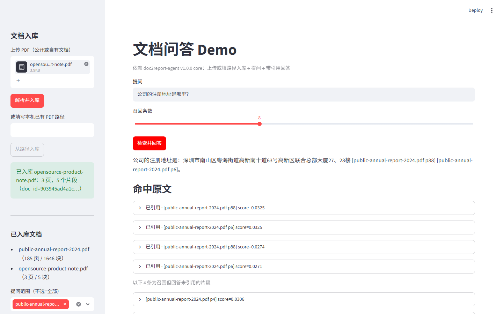
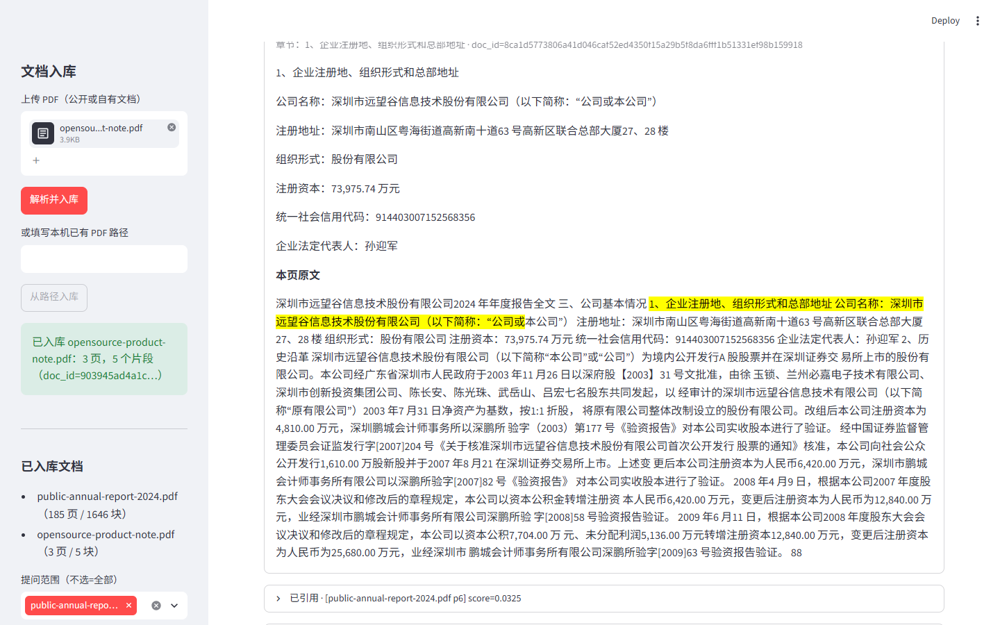
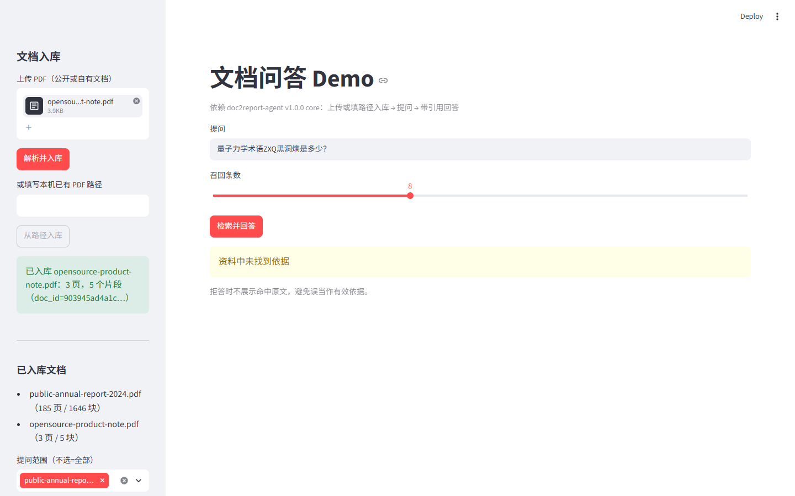
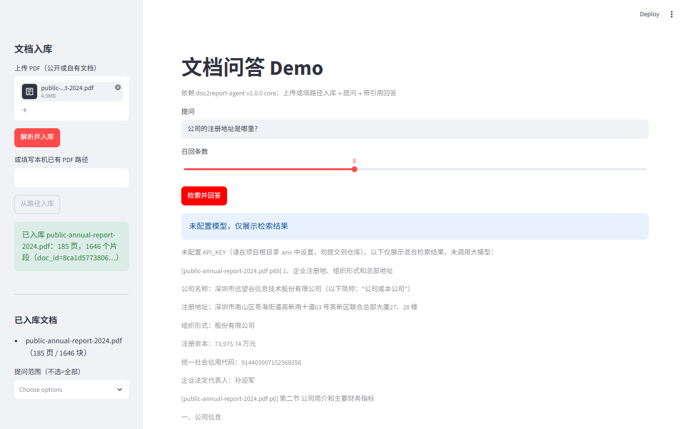
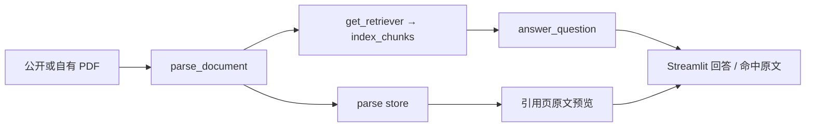

# doc-qa-demo

依赖 [doc2report-agent](https://github.com/xjsaber/doc2report-agent) **v1.0.0** core 的独立文档问答 Demo（薄仓库：Streamlit 入库 / 提问 / 带引用回答；不复制 core 源码）。

与 [doc2report-agent](https://github.com/xjsaber/doc2report-agent) 的关系：本仓只调用其 `docs/core-api.md` 公开接口（`parse_document`、`get_retriever`、`answer_question`、`load_dotenv_config`、`Citation` / `split_cited_citations`、parse store 的 `get_document` / `list_document_ids`）。报告生成与 LangGraph 流程不在本仓范围。

## 截图

真实 Streamlit 页面 + 真实模型 **deepseek-flash**（DeepSeek API），文档为公开年报 PDF 与现场生成的开源产品说明 PDF（PDF 不入库）。scripts/screenshots.py + Playwright，等运行指示消失再截。拍摄日期 **2026-11-02**；对应提交说明为 [real-shots]（本机 commit 以 git log 为准）。









## 架构



## 快速开始

需要 Python ≥3.12（本机实测 3.12.10）。样本 PDF 请自备公开文档放到 `data/`（该目录与 `*.pdf` 已 gitignore）。

### Windows（PowerShell）

```powershell
python -m venv .venv
.\.venv\Scripts\Activate.ps1
python -m pip install -U pip
python -m pip install -e ".[dev,embedding]"
Copy-Item .env.example .env
# 编辑 .env：可填 API_KEY；默认 RETRIEVER=memory

# 首次使用本地向量模型时显式下载（权重不入库；运行时不静默联网）
python -m core.index.embeddings --download-model

streamlit run app\app.py
```

### Linux / WSL / macOS

```bash
python3 -m venv .venv
source .venv/bin/activate
pip install -U pip
pip install -e ".[dev,embedding]"
cp .env.example .env
# 编辑 .env：可填 API_KEY；Linux 可将 RETRIEVER 设为 milvus（需额外环境）

python -m core.index.embeddings --download-model
streamlit run app/app.py
```

未配置 `API_KEY` 时进入「只检索」模式：页面提示「未配置模型，仅展示检索结果」。

## 测试

默认 `EMBEDDING_BACKEND=fake` + `FakeChatModel`，不联网、不下模型。

```powershell
python -m pytest -q -rs -p no:cacheprovider --basetemp=$env:LOCALAPPDATA\Temp\dqa-pytest
```

- **Windows 本机（本次）**：`10 passed`
- **GitHub Actions**：见仓库 Actions（ubuntu-latest / Python 3.12）；scaffold 与 multi-doc 推送后已出现成功记录，本轮 push 后以最新运行为准

## 已知局限

- 进程内 parse store / memory 检索：刷新页面后需重新入库
- 原生 Windows 上 Milvus Lite 不可用，默认 `RETRIEVER=memory`
- 无专用 `get_page_text` 接口：引用预览用 `get_document` + 页文本最小包装
- 本机无模型 Key 时，带引用截图依赖 `DOC_QA_FAKE_CHAT_REPLY`（见 `scripts/screenshots.py`）

## 开发约定

见 `AGENTS.md`、`docs/ROADMAP.md`、`docs/devlog/`。
